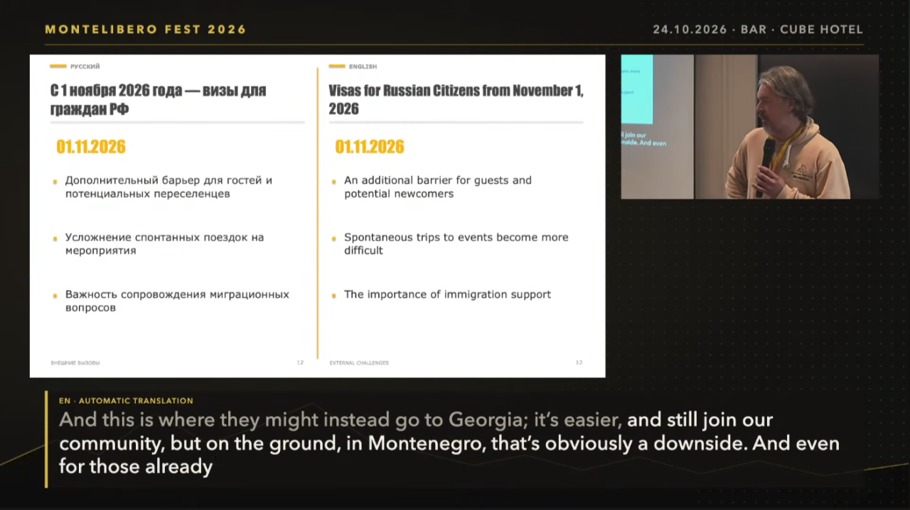

# 8 Hours of Live AI Translation for Just $20 - An Open-Source Project in Action

**Andrei Velikoredchanin**  
*Published October 31, 2026*

What if you could provide real-time translation at an international conference without expensive interpretation equipment or dedicated human interpreters?

On October 24, 2026, at [Montelibero](https://montelibero.org/) Fest in Bar, Montenegro, I had the opportunity to test an open-source AI translation system I developed in a real-world environment.

The result: approximately 8 hours of live translation, with AI API costs of just over $20.  
And, most importantly, the attendees were happy with the experience.

## How It Started

The idea originally came from a personal problem.

Despite having lived in the United States for two years, I sometimes find spoken English challenging, especially during technical interviews and video calls. After a long break from regular English conversations, understanding fast speech can become difficult.

As a software developer working with Rust, Go, and AI systems, I decided to build my own solution.

My first project, [TRANSONO](https://github.com/UncleAndy/transono), is an open-source Rust-based framework for audio processing and real-time speech translation.

It includes a terminal-based application capable of providing bidirectional speech translation during online meetings, using virtual audio devices and AI models.

But I soon realized that the same technology could solve a much broader problem.

## From Personal Translator to Conference Infrastructure

This led to my second project: [AI-Translator](https://github.com/UncleAndy/ai-translator).

Unlike a traditional translation application, AI-Translator is designed as a flexible bridge between audio sources, AI translation models, and multiple output destinations.

Its architecture is based on a simple principle:

**One translation stream. Multiple independent outputs.**

The application receives spoken audio, processes it through an AI translation service, and distributes the translated text and audio to different destinations simultaneously.

Currently, the system supports:

- Live subtitles displayed in a browser or on a large screen.
- WebSocket streaming for integration with broadcasting software and other applications.
- Subtitle files for recording and post-processing.
- Telegram integration for distributing translated text and audio.
- Audio output for listening to translated speech.

The system uses OpenAI's real-time translation capabilities, while its modular architecture allows additional AI providers and output integrations to be added in the future.

The software is developed in Rust, with releases for Linux, Windows, and Apple Silicon Macs.

## The First Real-World Test: Montelibero Fest 2026

During [Montelibero](https://montelibero.org/) Fest, speakers presented their ideas on stage, often in Russian.

AI-Translator processed their speech and generated English subtitles in real time.

The translations were displayed in several ways:

**On the event's video stream:** English subtitles appeared alongside the speaker or presentation slides.

**On a separate display:** A full-screen web interface showed the original speech and its English translation.

**On YouTube:** The translation stream was delivered through WebSocket and used to generate subtitles for the live broadcast.

The audience could follow presentations without requiring speakers to switch languages.

This was particularly important for an international community like [Montelibero](https://montelibero.org/), where people from different countries come together to discuss common ideas.

Of course, AI interpretation is not perfect. Translation accuracy, latency, network stability, and handling continuous speech are all important engineering challenges.

But this event demonstrated something valuable: modern AI models, combined with relatively simple open-source infrastructure, can already provide practical live translation at a remarkably low cost.

[Montelibero Festival 2026 - International Communities: What We Are Building (embedded video)](https://www.youtube.com/live/vvJRLUW9GcE?si=4y_YREzF8kWZz86w&t=2113)

## What Surprised Me Most

The cost.

The application operated in translation mode for approximately eight hours.

The total OpenAI API consumption was just over $20.

That is roughly $2.50 per hour for the AI translation service.

For small conferences, community events, educational workshops, and independent organizations, this kind of affordability could make multilingual communication much more accessible.

## What's Next?

AI-Translator is still at an early stage, and there is plenty of room for improvement.

My plans include extending support for different AI providers, adding new subtitle and audio destinations, improving integration with broadcasting platforms, and making deployment easier.

Both projects are open source, and I welcome feedback, ideas, and contributions.

GitHub:

- **AI-Translator:** https://github.com/UncleAndy/ai-translator
- **TRANSONO:** https://github.com/UncleAndy/transono

I believe one of the most exciting applications of AI is not replacing human communication, but removing the barriers that prevent it.

People should be able to speak their own language and still understand each other.

That's the future I'm trying to help build.

#OpenSource #RustLang #ArtificialIntelligence #RealTimeTranslation #SpeechAI #SoftwareEngineering #Montelibero #AI

---

